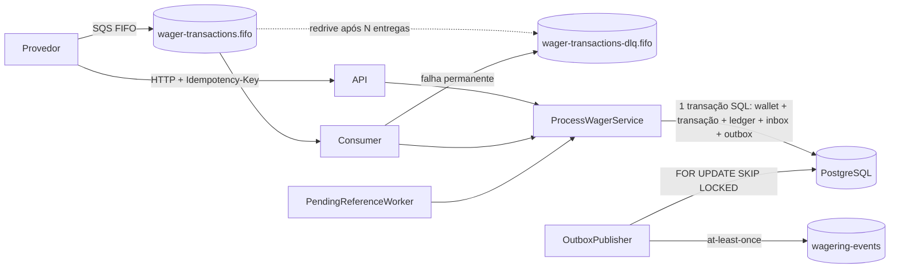

# Arquitetura

Este documento explica as decisões do Distributed Wagering Processor, os trade-offs aceitos e o que ficou de fora. O enunciado está em [docs/CHALLENGE.md](docs/CHALLENGE.md).

## 1. Visão geral



Cada instância roda tudo: API HTTP, consumer SQS, publisher da outbox e worker de referências pendentes. Não há líder, estado em memória compartilhado nem lock global. O que garante a correção entre instâncias é o PostgreSQL: lock de linha por wallet, constraints, índices únicos e triggers.

Camadas:

| Pasta | Responsabilidade |
|---|---|
| `src/domain` | `Money`, `Wallet`, `WagerTransaction`, `WalletLedgerEntry`, eventos e `OutboxMessage`. TypeScript puro, sem Nest nem ORM. |
| `src/application` | Use cases (`ProcessWagerService`, `WalletService`, `PendingReferenceWorker`), validação de entrada e hash canônico. |
| `src/infrastructure` | MikroORM (EntitySchema, mappers, migrations), SQS (consumer e publisher), logs e métricas. |
| `src/http` | Controllers, mapa de erros para HTTP e o `ProviderAuthGuard` no-op. |

O domínio segue a regra do enunciado: construtor privado, factories `create`/`open` que validam, e `rehydrate` que só reconstrói o estado persistido.

## 2. Por que MikroORM e como ele é usado

Escolhi **MikroORM 7** pelos motivos citados no enunciado: Unit of Work, Identity Map, `em.transactional()` e `LockMode` explícitos.

- **Sem decorators no domínio.** As tabelas são mapeadas com `EntitySchema` para *records* de persistência (`src/infrastructure/database/entities.ts`). Mappers convertem records em objetos de domínio e vice-versa. Assim o domínio não conhece o ORM, como o enunciado pede.
- **`Money` na persistência.** Valor e moeda ficam em colunas separadas. O valor é `numeric(20,2)`, lido pelo `DecimalType` como **string**, nunca como `number`, e reidratado com `Money.from`.
- **Transações.** Cada operação roda em `em.fork().transactional(...)`. O lock da wallet usa `LockMode.PESSIMISTIC_WRITE` (`SELECT ... FOR UPDATE`), e a reconciliação usa `PESSIMISTIC_READ` (`FOR SHARE`).
- **Ordem de escrita explícita.** Os records não declaram relações no ORM, então o use case faz dois `flush` dentro da mesma transação: primeiro a transação (e o UPDATE da wallet), depois ledger e outbox, que referenciam a transação por FK. Os dois `flush` são atômicos porque estão na mesma transação SQL.
- **Migrations escritas à mão.** São SQL revisável, registradas em `migrationsList` e com `down()`. O CI roda `up`, `down`, `down` e `up`.

## 3. Dinheiro

- **`decimal.js` isolado.** `Decimal.clone` com precisão 40, para que nenhuma configuração global vaze. Como só existem soma e subtração sobre valores de 2 casas, nunca há arredondamento.
- **Entrada estrita.** A regex é `^(0|[1-9]\d{0,17})(\.\d{1,2})?$`. Ela rejeita `NaN`, `Infinity`, notação científica, string vazia, espaços, zeros à esquerda, mais de 2 casas, negativos e valores acima de `numeric(20,2)`. Um `amount` que chega como `number` no JSON também é rejeitado.
- **Saída sempre com 2 casas** (`"25.00"`).
- **Multi-moeda no modelo.** Operar moedas diferentes lança `CURRENCY_MISMATCH`, o que está coberto por testes. Na prática, tudo usa BRL.
- **No banco**, o tipo `numeric(20,2)` é exato e a soma do ledger também é feita em `numeric` e lida como texto.

## 4. Concorrência

**Estratégia: lock pessimista por wallet.**

```
BEGIN
  SET LOCAL lock_timeout = '5s'
  SELECT ... FROM wallets WHERE id = $1 FOR UPDATE      -- serializa só esta wallet
  -- idempotência, referência, regras, cálculo do saldo
  UPDATE wallets / INSERT transação, ledger, inbox, outbox
COMMIT
```

- A unidade de concorrência é a `walletId`. Operações na mesma wallet esperam umas pelas outras, inclusive entre instâncias diferentes. Wallets diferentes rodam em paralelo, sem lock global.
- O `read → calculate → update` acontece **dentro** do lock, então não há lost update.
- **Por que não optimistic locking.** Numa wallet quente, com várias apostas simultâneas no mesmo jogador, o optimistic gera uma tempestade de retries. O pessimista serializa sem desperdiçar trabalho, e a transação é curta (poucos ms).
- O `lock_timeout` limita a espera. Se estourar, a resposta é `503 TRANSIENT_FAILURE`, que pode ser reenviada com a mesma chave sem risco, e o caso é contado em `wallet_lock_timeouts_total`.
- **Sem deadlock.** Cada operação trava uma única wallet. O worker de referências pendentes segue a mesma ordem (wallet, depois transação).
- **`version`.** Começa em 1 na criação, mesmo quando há crédito de abertura, e só incrementa quando o saldo muda. Com o lock pessimista ele não é usado para controle otimista, mas fica disponível para auditoria e para o evento `WalletBalanceChanged`.
- **A última barreira é o schema.** Mesmo que o código falhasse, `CHECK (balance >= 0)` impede saldo negativo, e os índices únicos impedem débito duplicado.
- **Ordenação do SQS.** O `MessageGroupId` da fila FIFO é a `walletId`, mas isso é só otimização: a correção não depende da ordem nem da deduplicação do broker.

## 5. Idempotência

- **Chave.** O header `Idempotency-Key` é obrigatório. No SQS, a chave vem em `data.idempotencyKey`. O padrão recomendado é `"{providerId}:{externalTransactionId}"`.
- **Persistência.** A chave fica na própria `wager_transactions`, com `UNIQUE (idempotency_key)` e `UNIQUE (provider_id, external_transaction_id)`. Não há cache em memória.
- **`payloadHash`.**
  - É o SHA-256 em hex do **JSON canônico** do subconjunto de negócio: `providerId`, `externalTransactionId`, `playerId`, `walletId`, `roundId`, `gameId`, `kind`, `money {amount, currency}` e `referenceExternalTransactionId`.
  - Canônico quer dizer chaves ordenadas recursivamente, sem espaços e com campos `undefined` removidos.
  - O `amount` é normalizado antes do hash (`"10"` e `"10.00"` geram o mesmo hash).
  - O header e metadados de transporte não entram.
- **Replay.** Mesma chave e mesmo hash devolvem o **resultado original**: status, `failureCode` e o **saldo observado naquele momento**, gravado em `observed_balance`, com `idempotentReplay: true` e o mesmo código HTTP.
- **Conflito.** Mesma chave com outro hash, ou o mesmo `(providerId, externalTransactionId)` com outra chave, resulta em `409 IDEMPOTENCY_CONFLICT`. Nunca é tratado como replay.
- **Corrida entre wallets.** Duas requisições com a mesma chave mas `walletId` diferentes travam wallets diferentes. Nesse caso o índice único decide quem grava. A perdedora recebe `UniqueConstraintViolation`, relê a linha vencedora e responde com replay ou conflito.
- **SQS.** A inbox `(consumer_name, message_id)` é gravada na mesma transação. Ela detecta mensagens repetidas (métrica `inbox_duplicates_total`), e a idempotência por chave garante o resultado.

## 6. Garantias no schema

Ficam em `src/infrastructure/database/migrations`.

| Garantia | Como |
|---|---|
| Uma wallet por player e moeda | `UNIQUE (player_id, currency)` |
| Saldo nunca negativo | `CHECK (balance >= 0)` |
| Sem transação duplicada | `UNIQUE (idempotency_key)` e `UNIQUE (provider_id, external_transaction_id)` |
| REFUND e ROLLBACK exigem referência | `CHECK` por `kind` |
| Reversão no máximo uma vez por tipo | índice único parcial `(reference_transaction_id, kind) WHERE status = 'PROCESSED' AND kind IN ('REFUND','ROLLBACK')` |
| Status terminal é final | trigger `BEFORE UPDATE` que barra mudanças em PROCESSED, REJECTED e FAILED |
| `failure_code` existe se, e somente se, a transação é REJECTED ou FAILED | `CHECK` |
| No máximo um lançamento por transação | `UNIQUE (transaction_id)` |
| Lançamento balanceado | `CHECK (balance_after = balance_before ± amount)` conforme a direção |
| Ledger imutável | trigger que barra `UPDATE`, `DELETE` e `TRUNCATE` |
| Inbox deduplicada | `PRIMARY KEY (consumer_name, message_id)` |

No domínio, `WalletLedgerEntry` também é imutável estruturalmente: campos `readonly`, nenhum método de transição e `Object.freeze` na instância.

## 7. Regras de negócio e estados

```
PENDING ──► PROCESSED | REJECTED | FAILED | PENDING_REFERENCE
PENDING_REFERENCE ──► PROCESSED | REJECTED | FAILED | PENDING_REFERENCE (nova tentativa)
PROCESSED, REJECTED, FAILED: terminais (transicionar lança InvalidTransactionStateError)
```

As regras da seção 7 do enunciado estão em `applyWagerTransaction`, uma função pura sobre o estado já travado e testada em unidade.

| Operação | Saldo | Ledger |
|---|---|---|
| `BET` | débito; rejeita sem saldo (`INSUFFICIENT_FUNDS`) | 1 DEBIT |
| `WIN` | crédito | 1 CREDIT |
| `LOSS` | nenhum | nenhum |
| `REFUND` | crédito; só referencia `BET` PROCESSED | 1 CREDIT |
| `ROLLBACK` | inverso da referência (`BET`, `WIN` ou `REFUND`) | 1 lançamento invertido |

**Failure codes**, estáveis e legíveis por máquina:

| Código | Significado | O provedor deve |
|---|---|---|
| `INSUFFICIENT_FUNDS` | BET maior que o saldo | não reenviar igual |
| `REVERSAL_INSUFFICIENT_FUNDS` | reverter um crédito (ex.: ROLLBACK de WIN) deixaria o saldo negativo | investigar; é um caso operacionalmente diferente de aposta sem saldo |
| `CURRENCY_MISMATCH` | moeda diferente da wallet | corrigir o payload |
| `WALLET_PLAYER_MISMATCH` | a wallet não é do player | corrigir o payload |
| `REFERENCE_NOT_FOUND` | a referência não chegou dentro da janela de retry | desistir ou reenviar a referência e depois a reversão com nova chave |
| `REFERENCE_MISMATCH` | referência de outro provider, player, wallet, moeda ou rodada | corrigir o payload |
| `REFERENCE_KIND_NOT_ALLOWED` | REFUND só de BET; ROLLBACK de BET, WIN ou REFUND | corrigir o payload |
| `REFERENCE_NOT_PROCESSED` | a referência foi rejeitada, então não há o que reverter | desistir |
| `REFERENCE_ALREADY_REVERSED` | já revertida por uma operação do mesmo tipo | desistir |
| `AMOUNT_MISMATCH` | o valor difere do da referência (sem reversão parcial) | corrigir o payload |
| `INFRASTRUCTURE_FAILURE` | reservado para `FAILED` (falha permanente auditável) | contatar o operador |

### 7.1 Referências fora de ordem

- Uma reversão cuja referência ainda não existe é gravada como `PENDING_REFERENCE`, publica `WagerTransactionPendingReference` e responde `202`.
- O `PendingReferenceWorker` roda em todas as instâncias. Ele busca as transações vencidas, trava a wallet e depois a transação, confere se ainda estão pendentes (outra instância pode ter resolvido) e reaplica o mesmo `resolveAndApply` do fluxo normal.
- **Backoff exponencial**, `1s * 2^tentativa`, com teto de 60s.
- **Limite padrão de 10 tentativas**, uma janela de cerca de 6 minutos. A justificativa é que, em fluxos de provedor, a referência atrasada chega em segundos. Uma janela muito longa deixaria reversões "penduradas" e o saldo do jogador incerto. Os valores são configuráveis (`PENDING_REFERENCE_*`).
- Esgotado o limite, a transação vira `REJECTED` com `REFERENCE_NOT_FOUND` e publica `WagerTransactionRejected`.

## 8. Atomicidade e Transactional Outbox

- **Tudo na mesma transação SQL.** Transação, UPDATE da wallet, lançamento no ledger, inbox (quando vem do SQS) e eventos da outbox. Existe um teste que injeta uma falha no INSERT da outbox, via trigger no Postgres real, e confirma que nada sobra: nem transação, nem ledger, nem inbox, nem mudança de saldo.
- **Nenhum evento sai antes do commit.** Os eventos são linhas da tabela `outbox_messages`.
- **O `OutboxPublisher`** roda em todas as instâncias:
  1. abre uma transação e pega até N linhas vencidas com `FOR UPDATE SKIP LOCKED`. Dois publishers nunca pegam a mesma linha, e as linhas de um publisher que morreu são liberadas pelo Postgres;
  2. publica em lotes de 10 (`SendMessageBatch`) na fila `wagering-events`;
  3. marca `published_at` nas que deram certo e agenda retry com backoff (`attempts`, `next_attempt_at`) nas que falharam;
  4. faz o commit.
- **At-least-once.** Se o processo morre depois de o SQS aceitar a mensagem e antes do commit que marca a publicação, o evento sai de novo. Por isso o `eventId` (que é também o id da outbox) vai no envelope e como atributo da mensagem, e o consumidor deduplica por ele.
- **Trade-off aceito.** A transação do publisher fica aberta durante a chamada ao SQS. Isso segura uma conexão e os locks das linhas por alguns ms, mas é o que impede dois publishers de enviar a mesma linha. A alternativa seria um lease com `locked_until`, que tem mais estados e mais SQL, e não compensava no prazo.
- **Eventos.** São subclasses concretas da classe abstrata `IntegrationEvent`, com `eventType` e `version` no tipo. O `data` carrega `MoneyProps` (string), nunca `Money`.
  - `WagerTransactionProcessed`: toda transação aplicada, inclusive LOSS e OPENING.
  - `WagerTransactionRejected`
  - `WagerTransactionPendingReference`
  - `WalletBalanceChanged`: **só** quando o saldo muda.
- **Destino.** O enunciado não define para onde publicar, então criei a fila standard `wagering-events`. Num ambiente real seria um tópico SNS ou EventBridge, trocando apenas o adapter.

## 9. Consumer SQS

- **Mesmo use case do HTTP** (`ProcessWagerService.execute`), com a inbox gravada dentro da transação.
- **`ack` (DeleteMessage) só depois do commit.** Se o processo morre entre o commit e o ack, a reentrega vira replay e recebe ack. Há um teste com esse cenário exato.
- **Classificação de erros:**

| Tipo | Exemplos | Ação |
|---|---|---|
| Negócio | saldo insuficiente, referência inválida | a transação fica `REJECTED` (auditável) e recebe **ack** |
| Transitório | conexão recusada, `lock_timeout`, deadlock, erro desconhecido | **retry**: `ChangeMessageVisibility` com `base * 2^(receiveCount-1)`, teto de 300s |
| Permanente | JSON inválido, tipo desconhecido, payload inválido, wallet inexistente, conflito de idempotência | **DLQ imediata**, com o atributo `failureReason`, e depois `DeleteMessage` |

- **Limite de tentativas.** É a `redrivePolicy.maxReceiveCount = 5` da fila principal. Depois disso o próprio SQS move a mensagem para a DLQ.
- **SIGTERM.** `enableShutdownHooks` dispara `beforeApplicationShutdown`: o consumer para de fazer polling (aborta o long-poll), espera a mensagem em andamento terminar (até `CONSUMER_SHUTDOWN_GRACE_MS`) e devolve as mensagens do lote que não começaram com visibilidade 0. Só depois o pool do Postgres e o cliente SQS fecham. Uma mensagem interrompida à força (SIGKILL) reaparece depois do visibility timeout, e o teste de crash cobre isso.

## 10. HTTP

| Código | Quando | Pode reenviar? |
|---|---|---|
| `200` | `PROCESSED` (também no replay) | — |
| `201` | wallet criada | — |
| `202` | `PENDING_REFERENCE`: aceita, aplicada depois | consultar depois |
| `400 INVALID_PAYLOAD` | payload, `Idempotency-Key` ou cursor inválido | não, corrigir antes |
| `404 *_NOT_FOUND` | wallet ou transação inexistente | não |
| `409 IDEMPOTENCY_CONFLICT` | chave reutilizada com outro payload | não |
| `409 WALLET_ALREADY_EXISTS` | player já tem wallet nessa moeda | não |
| `422` + `failureCode` | rejeição de negócio (`status: REJECTED`) | não, a menos que o motivo mude |
| `503 TRANSIENT_FAILURE` + `Retry-After` | banco fora, `lock_timeout`, deadlock | **sim, com a mesma chave** |
| `500 INTERNAL_ERROR` | bug | — |

Erros têm sempre o formato `{ "error": { "code", "message" } }`. As respostas de transação têm o formato `{ transactionId, status, balance, idempotentReplay, failureCode? }`.

**Ledger.** A paginação é *keyset* sobre a coluna `seq` (identity), e o cursor é o `seq` codificado em base64url, opaco para o cliente. Por isso a paginação é estável mesmo com inserções concorrentes.

**Reconciliação.** Trava a wallet com `FOR SHARE`, soma o ledger no banco e compara com o saldo guardado. Uma divergência **não é corrigida**: ela é logada (`warn`), contada em `reconciliation_divergences_total` e devolvida com `consistent: false`.

## 11. Observabilidade

- **Logs.** JSON, uma linha por evento (`JsonLogger`), com campos no topo: `correlationId`, `messageId`, `transactionId`, `walletId`, `providerId`, `status` e `failureCode`. Os logs não carregam payloads completos nem dados pessoais além de ids.
  - No HTTP, o `correlationId` vem do header `X-Correlation-Id` ou é gerado.
  - No SQS, o `correlationId` é o `messageId`, e o `causationId` dos eventos aponta para a mensagem de origem.
- **Métricas.** Ficam em `GET /metrics`, no formato Prometheus, por instância:

| Métrica | O que mede |
|---|---|
| `wager_transactions_total{status,source}` | transações por status e origem |
| `duplicates_detected_total{source}`, `inbox_duplicates_total` | duplicatas detectadas |
| `consumer_retries_total`, `outbox_publish_retries_total`, `pending_reference_retries_total` | retries |
| `dlq_messages_total` | mensagens enviadas à DLQ |
| `wallet_lock_wait_ms` (histograma), `wallet_lock_timeouts_total` | espera e conflitos de lock |
| `outbox_lag_seconds`, `outbox_pending` | lag da outbox |
| `wager_processing_ms` (histograma) | latência de processamento |
| `reconciliation_divergences_total` | divergências encontradas na reconciliação |

- **Health.** `GET /health/live` responde sem tocar em dependências. `GET /health/ready` checa o PostgreSQL (`select 1`) e o SQS (`GetQueueUrl`) com timeout de 2s e devolve `503` se algum falhar. Nenhum dos dois exige autenticação.

## 12. Autenticação (decisão: não implementar)

A autenticação não vale pontos e competiria com o que vale. O ponto de extensão é o `ProviderAuthGuard`, no-op, aplicado aos controllers de wallet e wagering. Os de health ficam de fora.

Desenho que eu adotaria:

1. Um IdP externo (Keycloak no Docker Compose), com um *client* por provedor e o fluxo **client credentials** (OAuth2).
2. O guard valida o JWT pelo JWKS do IdP (assinatura, `iss`, `aud`, `exp`) e extrai o `providerId` de um claim.
3. Uma regra de domínio exige `token.providerId === body.providerId`, rejeitando com 403. Isso impede um provedor de mexer em transações de outro.
4. O SQS segue como canal interno confiável, mas a identidade do provedor na mensagem passa pelas mesmas validações de domínio de hoje.

## 13. Testes

Todos rodam contra **PostgreSQL e LocalStack reais**, via Docker Compose no CI. Nenhum mock de Postgres ou SQS.

| Suíte | O que cobre |
|---|---|
| `test/unit` (65) | `Money` (escala, entradas inválidas, imutabilidade, moeda), invariantes da `Wallet` e do ledger, regras de BET/WIN/LOSS/REFUND/ROLLBACK, máquina de estados, payload divergente |
| `test/integration/schema` | migrations reversíveis e cada constraint e trigger, com SQL direto que contorna a aplicação |
| `test/integration/wagering-api` | API completa, replay e conflito, rejeições, reversões, paginação, outbox; 100.00 contra 2 × 80.00 simultâneas; a mesma aposta 50× em paralelo; wallet quente; wallets em paralelo |
| `test/integration/messaging` | consumer (ack após commit, redelivery, morte entre commit e ack, DLQ imediata, retry até a DLQ com banco inacessível de verdade), atomicidade com falha injetada, publishers concorrentes, retry da outbox |
| `test/integration/pending-reference` | reversão antes da referência resolvida depois, e expiração com `REFERENCE_NOT_FOUND` |
| `test/concurrency` | **3 processos `bun` separados** com o serviço completo: wallet quente pelas 3 instâncias, a mesma aposta 50× espalhada, 3 consumers dividindo a fila com mensagens duplicadas, reversão fora de ordem, `SIGKILL` no meio da carga com uma nova instância assumindo |

**Invariante final.** Os arquivos de API e de concorrência chamam a reconciliação em todas as wallets que criaram e exigem `consistent: true`, ou seja, `saldo == ledger`.

## 14. Interpretações adotadas

- **Valores zero.** `BET`, `WIN`, `REFUND` e `ROLLBACK` exigem valor maior que zero. `LOSS` aceita `0.00` (registra o resultado sem mover saldo). Wallet com saldo inicial `0.00` não gera OPENING nem lançamento.
- **OPENING.** Usa o provider interno `internal`, com `externalTransactionId = opening:{walletId}`. É criado já `PROCESSED`, na mesma transação da wallet, e não pode ser submetido pela API nem pela fila.
- **ROLLBACK de REFUND.** É permitido, como diz o enunciado, e debita de novo o valor estornado.
- **"Revertida duas vezes pelo mesmo tipo".** Uma BET pode ter um REFUND **e** um ROLLBACK, porque o enunciado só proíbe repetir o mesmo tipo.
- **Wallet inexistente** responde `404` e não grava a transação: não há wallet para associar, e o FK exige uma. No SQS, a mensagem vai para a DLQ para auditoria.
- **Criação de wallet** não usa `Idempotency-Key`. A unicidade `(playerId, currency)` já torna a repetição um `409` seguro.
- **A WIN pode, mas não precisa,** referenciar a BET da rodada. A referência não é validada para WIN.

## 15. Limitações e próximos passos

- **Métricas por instância, em memória.** Funcionam com um Prometheus coletando de cada réplica, mas reiniciam com o processo. O passo seguinte seria `prom-client` ou OpenTelemetry.
- **Publisher com transação aberta durante a chamada ao SQS** (seção 8). Em volume alto, eu trocaria por lease (`locked_until`) ou por logical replication / CDC.
- **Status `FAILED`.** Está modelado e reservado. Hoje, falhas de infraestrutura sempre são tratadas como transitórias (retry até a DLQ), sem marcar a transação como `FAILED`. A mensagem fica auditável na DLQ.
- **Sem teste de carga.** O `test:load` opcional não foi feito.
- **Sem autenticação** (seção 12).
- **Não há worker que reprocesse a DLQ.** O reprocessamento é manual, com o motivo no atributo `failureReason`.
